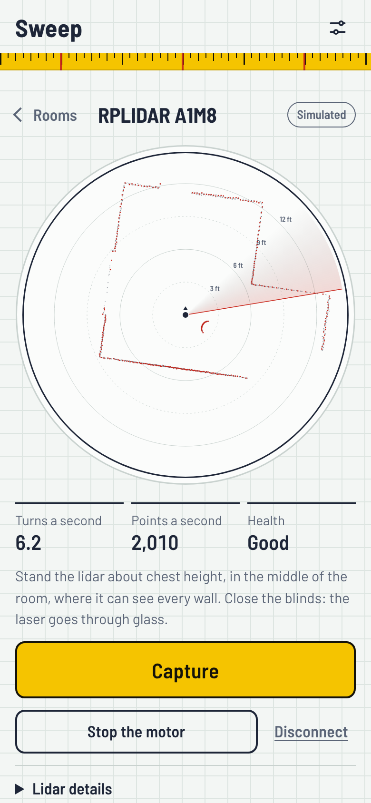
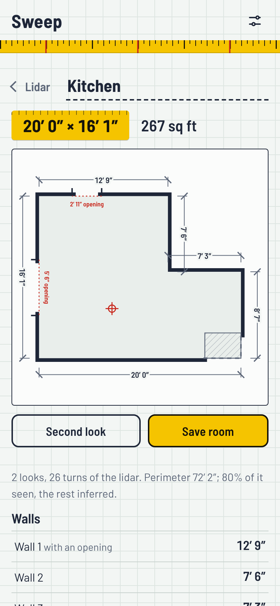
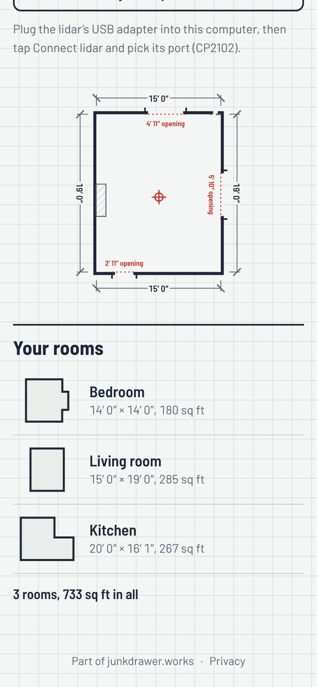

# Sweep

**Use it: [sweep.junkdrawer.works](https://sweep.junkdrawer.works/)**

**A measured floor plan from one spin of a lidar.** Plug a Slamtec RPLIDAR A1 into your phone or computer, stand it in the middle of a room and tap Capture. A few seconds later Sweep draws the walls with every length marked, finds the doorways and openings, and gives you the plan as an image, a drawing or a CAD file. No lidar? The sample rooms show the whole thing with a simulated one.

<p align="center">
  
  &nbsp;
  
  &nbsp;
  
</p>

## How it works

- **Connecting.** Chrome or Edge on a computer reach the lidar's USB adapter through Web Serial. Chrome on Android
  doesn't list USB adapters under Web Serial, so there Sweep drives the adapter's CP2102 chip itself over WebUSB, with
  the requests Silicon Labs documents. iPhones, iPads and Firefox can't reach USB devices; the sample rooms work
  anywhere.
- **A look.** The lidar spins about six times a second and measures 2,000 points a second. A look lasts a few seconds,
  15 to 20 turns. During the countdown, get below the beam or out of the room.
- **A second look.** Anything close to the lidar, usually you, hides part of the room. Sweep says how many degrees
  were blocked; move to the other side, tap Second look, and it combines the two.
- **The plan.** Sweep keeps the surfaces that stayed put from turn to turn, fits straight lines to them and squares
  them up. It sorts the lines into walls, furniture standing in front of a wall, and things seen through a doorway,
  then joins the walls at their corners. Walls it had to infer are dashed. Openings (doorways, archways, glass) are
  marked with their width, and furniture is hatched.
- **Checking it against a tape.** Tap a wall and type what your tape measure says. Sweep works out the correction and
  applies it to every room.
- **Exports.** The image (PNG) and drawing (SVG) carry the measurements. The CAD file is DXF (R12, millimetres) with
  layers `OUTLINE`, `WALLS`, `INFERRED`, `OPENINGS` and `OBJECTS`: in OpenSCAD,
  `linear_extrude(2400) import("kitchen.dxf", layer="OUTLINE");` gives you the room.
- No account and no server. Rooms and settings stay in your browser, and Settings backs them up to a file. It works
  offline and installs to a phone's home screen.

## How well it measures

In the simulator, which models the A1's noise (about 2 mm plus 0.4% of the distance), its dropouts at glancing
angles, glass, and a person standing beside it, the three sample rooms come out within 5 mm overall and within 2 cm
wall by wall, with openings within 8 cm. Over 84 random placements of the lidar, 77 were within 4 cm and 2% of the
true size; the rest were spots where a corner of the room couldn't be seen at all (inside the leg of the L, behind
the fridge) or a single look with the person in the way.

**Nothing has been measured with a real lidar yet.** The first real rooms, checked against a tape, will say how close
it gets. Settings has the distance correction for that.

## The lidar

An RPLIDAR A1M8 with the USB adapter board it comes with (the board has a CP2102 chip and a micro-USB socket), a
micro-USB data cable, and for a phone a USB-C (or micro-USB) OTG adapter. Stand it at about chest height, above the
furniture: `hardware/` has a printable stand that puts it on a camera tripod.

## Running it

It's a static site: plain HTML, CSS and JavaScript, with no build step.

```sh
npx serve .                   # or any static file server, then open the printed address
npm test                      # unit tests, then uses it in Chromium through the real page (needs Playwright)
node tools/screenshots.mjs    # redraws docs/*.png and og.png
node tools/make-icons.mjs     # redraws the PNG icons from icon.svg
npm install && npm run build # dist/sweep.html: the whole app in one file (it runs the sample rooms)
```

To put it online with GitHub Pages: **Settings → Pages → Build and deployment → Deploy from a branch**, then pick
`main` and `/ (root)`. The `CNAME` file serves it at sweep.junkdrawer.works.

### Files

- `js/protocol.js`: the RPLIDAR byte protocol: commands, answer descriptors, measurements, and a streaming parser
  that finds its step again when a byte goes missing.
- `js/transports.js`: Web Serial, WebUSB (Sweep's own CP2102 driver) and the simulated lidar, all with one shape.
- `js/lidar.js`: talks to the lidar: device info, health, scanning, the motor (DTR on the A1's adapter stops it).
- `js/capture.js`: measurements into turns of the lidar, turns into looks, looks into storage.
- `js/plan.js`: looks into a floor plan: steady surfaces, straight lines, walls and corners, openings, furniture.
- `js/geom.js`: the geometry those use.
- `js/sim.js`: the simulated lidar and the three sample rooms.
- `js/render.js`: the plan as SVG, and the live view on a canvas.
- `js/export.js`: the image, drawing, DXF and backups. `js/units.js`: feet and inches or metres. `js/store.js`:
  rooms and settings in localStorage.
- `js/app.js`: the screens.
- `scripts/build.mjs`: bundles everything into one HTML file with esbuild. That copy runs the sample rooms; a framed
  page can't reach USB or start downloads, so it points at the site for those.
- `hardware/`: the tripod stand for the A1M8 (STLs, and the Python script that makes them).
- `test/unit/`: the protocol, the CP2102 setup, the plan against the sample rooms' true sizes, units, DXF and
  storage (`node --test`). `test/e2e.mjs`: the whole app in Chromium, including a stand-in CP2102 on WebUSB and a
  stand-in serial port on Web Serial.
- `fonts/`: Barlow and Barlow Semi Condensed (SIL Open Font License), served from here so nothing loads from
  elsewhere. `tools/fix-prime.py` narrows their prime (′), which they draw half an em wide.
- `sw.js`: keeps a copy for using offline, and opens from it when the connection isn't answering. `FILES` in it is a
  fingerprint of the files it keeps: change one and `npm test` says what to set it to, so a release never leaves the
  copy half old.

Sweep isn't made by or connected with Slamtec. RPLIDAR is their name for their lidars.
