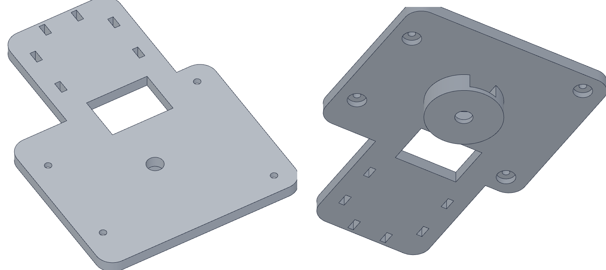

# The Sweep stand

A plate that the RPLIDAR A1M8 screws onto, with a captive 1/4"-20 nut so it sits on any camera tripod at chest
height, and an apron that holds the lidar's USB adapter board with zip ties, so a tug on the USB cable pulls the
stand rather than the lidar's socket.

- `sweep-fit-test.stl`: print this first (roughly 20 minutes on a Bambu P1S). It checks that the four holes line up with the lidar's
  feet, that the cable's plug fits through, and that the nut slides into its slot and a tripod screw finds it.
- `sweep-stand.stl`: the stand (under an hour).
- `sweep_stand.py`: makes both: `python3 hardware/sweep_stand.py` (needs `pip install manifold3d trimesh`).

**Printing.** PLA or PETG, 0.2 mm layers, 3 walls, 20% infill, no supports. Leave each part as it lands on the plate:
the face the lidar stands on prints against the build plate, so it comes out flat, and the nut slot's roof is a short
bridge.

**Parts.** 4 M2.5 × 6 mm screws (socket or button head) for the lidar's four feet, two 1/4"-20 hex nuts (7/16"
across the flats; the fit test keeps the first, because a nut pushed into its slot doesn't come back out), and 3 zip
ties up to 4.8 mm wide: two for the adapter board, one for the USB cable.

**Putting it together.** With the lidar upside down on a towel, set the stand on it face down: the four feet on the
four holes, the cable socket over the rectangular opening (the apron sticks out on the socket's side). Screw it on.
Plug the cable in through the opening and lay it along the opening towards the apron. Slide the nut into the slot in
the round boss with two of its flat sides against the slot's walls, so a corner goes in first, until it sits over the
hole. Turn it over, lay the adapter board on the apron with its micro-USB end outwards, and zip-tie it down.

**What it's based on.** The feet's positions and sizes come from a model of the A1M8 (hidmic/airi-hw's
`RPLIDAR-A1M8-R1.stl`): four hex standoffs, 5 mm across the flats, with a 2.0 mm bore, which is M2.5 thread. Nobody
has tried the stand on a real lidar yet; the fit test is there to find out cheaply.
